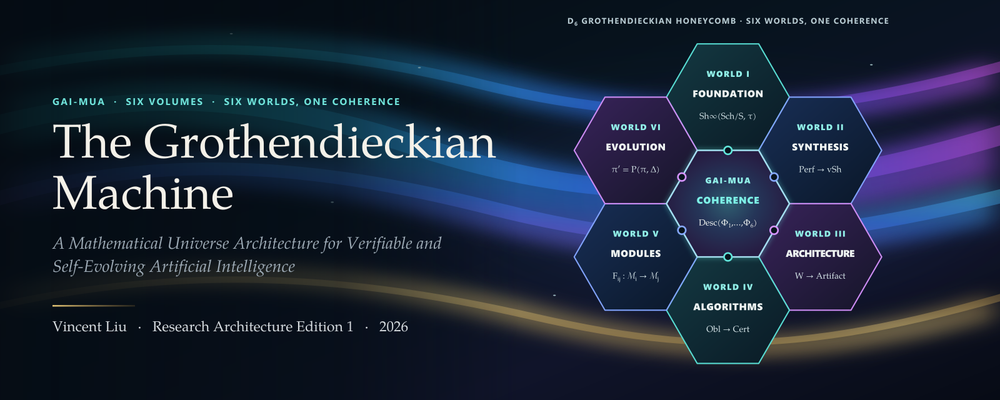
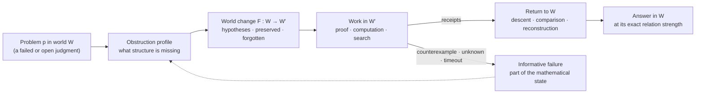
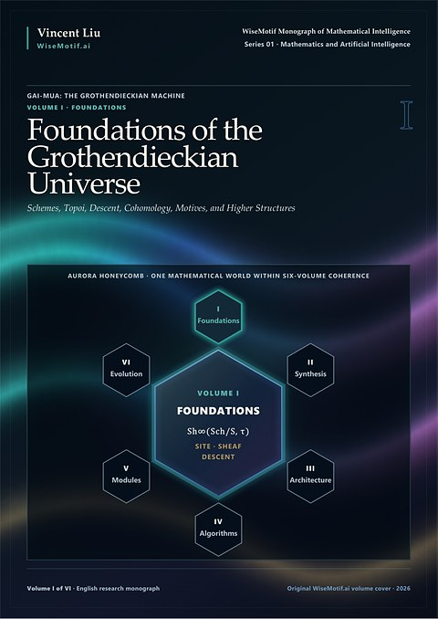
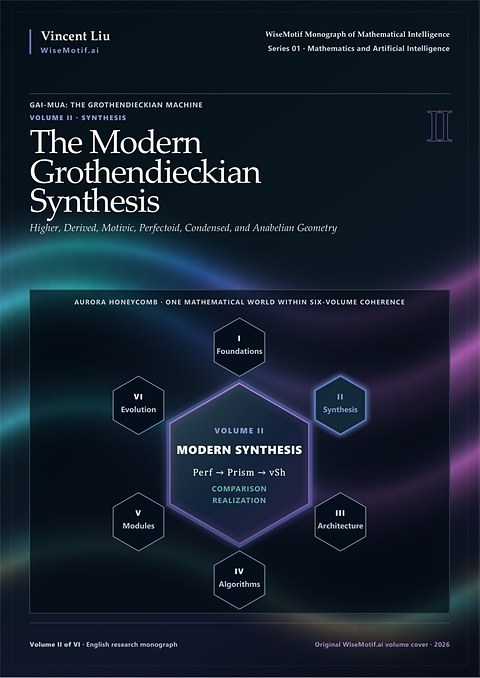
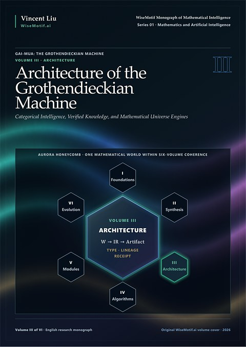
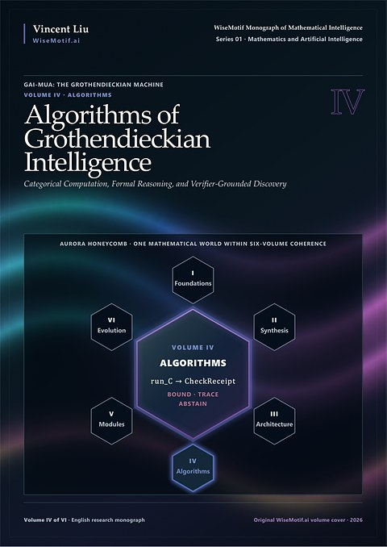
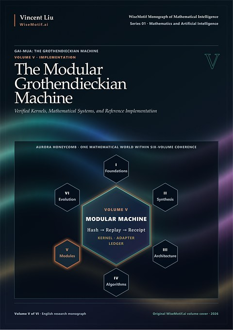
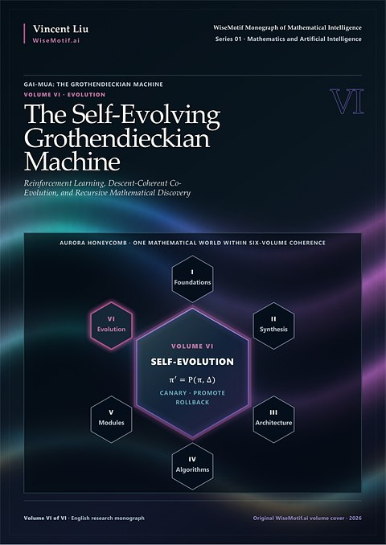

<p align="center">
  <a href="https://doi.org/10.5281/zenodo.23480696"></a>
</p>

<p align="center">
  <a href="https://doi.org/10.5281/zenodo.23480696"></a>
  <a href="https://creativecommons.org/licenses/by-nc-nd/4.0/"></a>
  <a href="https://github.com/AlienMuse/grothendieckian-machine/releases/tag/v1.0.0"></a>
  
  
  
  <a href="VERIFY.md"></a>
  <a href="VERIFY.md"></a>
</p>

<p align="center">
  <b><a href="https://github.com/AlienMuse/grothendieckian-machine/releases/download/v1.0.0/GAI-MUA-v1.0.0-Preview.pdf">Read the preview</a></b> (328 pages, 51.8 MB) ·
  <a href="#download">Download</a> ·
  <a href="#the-six-volumes">Volumes</a> ·
  <a href="#citation">Cite</a> ·
  <a href="VERIFY.md">Verify</a> ·
  <a href="README.zh-CN.md">中文</a>
</p>

<br>

> *Major advances frequently arise not from manipulating isolated formulas more aggressively, but from
> constructing an ambient world in which the objects, transports, invariants, and local-to-global laws of a
> problem become visible.*
> <br>— Series Note

**GAI-MUA: The Grothendieckian Machine** is a six-volume monograph that joins the substance of structural
mathematics — schemes, topoi, descent, cohomology, motives, and higher, derived, perfectoid, condensed and
anabelian geometry — with the design of artificial-intelligence systems for mathematics. It asks how
mathematical worlds are formed, how claims are warranted within and between them, how structure can be
represented faithfully in typed data, and how computation can assist mathematics under exact sources,
explicit hypotheses, independent verification, and human publication authority.

Its central thesis: **mathematical intelligence advances through constructing, comparing, and governing
worlds in which answers have exact meaning.**

<table>
  <tr>
    <td align="center"><b>6</b><br><sub>volumes,<br>one integrated work</sub></td>
    <td align="center"><b>603</b><br><sub>chapters</sub></td>
    <td align="center"><b>14,905</b><br><sub>pages</sub></td>
    <td align="center"><b>110,000+</b><br><sub>formulas<br>20,531 displayed · 8,022 numbered</sub></td>
    <td align="center"><b>11,397</b><br><sub>numbered<br>sections</sub></td>
    <td align="center"><b>830</b><br><sub>figures</sub></td>
    <td align="center"><b>126</b><br><sub>algorithm contracts<br>ALG-001 … ALG-126</sub></td>
  </tr>
</table>

The work is, at once:

- **a mathematical monograph** — a reconstruction of the Grothendieckian and post-Grothendieckian world, from
  EGA, SGA and *Pursuing Stacks* to perfectoid, prismatic and condensed mathematics, written with exact
  hypotheses and source-aware proof lineage;
- **a study in mathematical method and genealogy** — how a theorem, a definition or a research program
  actually entered the record, down to the smallest supporting source unit;
- **an architecture for AI for mathematics** — in which a world carries its ambient category, invariants and
  supported boundary; a theorem its hypotheses, dependency closure, source lineage, proof receipts and epistemic
  status; a bridge what it preserves and what it loses — and in which failure is an output rather than an error;
- **a research program in governed self-evolution** — for systems that improve their retrieval, proof search
  and policies while mathematical truth stays attached to source, proof, and review.

## The method: changing ambient worlds

Many hard problems are hard because the language in which they are posed suppresses the structure needed to
state the right invariant, comparison, or gluing law. A characteristic Grothendieckian response diagnoses
that pressure, **changes the ambient world** in a typed manner, and asks whether scattered phenomena become
functorial, local, representable, or reconstructible — then records what was gained, what was lost, and how
the result returns to the original question.



The work distinguishes eight such operations, each with its own hypotheses and effects: **relativization**
(families over a base), **representability**, **localization and descent**, **categorical ascent** (sets →
groupoids → higher stacks), **derivation and stabilization**, **comparison through a larger mediating world**
(étale, Betti, de Rham, crystalline, prismatic …), **completion, almost equivalence and tilting**, and
**reconstruction from shadows** (Galois and anabelian geometry). Together they give disciplined content to
Grothendieck's image of the *rising sea*: a resistant problem is surrounded by a more capacious theory until
structural relations replace direct assault — with every enlargement carrying an explicit loss profile and a
route back. Across all six volumes the deepest mathematical continuity is descent: local data yield global
objects under compatibility *and* effectivity.

### Worlds, bridges, obligations

The machine's unit of intelligence is the structured inquiry rather than the isolated answer.

- **A world** is a structured environment in which expressions are well formed, objects have types,
  morphisms have variance, locality has a specified meaning, and claims have admissible modes of
  verification — schematically
  $W = (\mathcal{C}, \mathcal{O}, \mathcal{M}, \tau, \mathcal{L}, \mathcal{I}, \mathcal{T}, \mathcal{H}, \mathcal{B})$:
  ambient category, objects, morphisms, locality, logical and universe discipline, invariants, admitted
  transformations, standing hypotheses — and the indispensable **boundary** $\mathcal{B}$ of what is
  actually supported.
- **A bridge** is a directed relation between worlds — a functor, adjunction, localization, realization,
  base change, comparison, truncation, completion, compiler, or reconstruction — recorded with its domain
  conditions, what it preserves, what it reflects, what it loses, and how one returns.
- **An obligation** is what a diagram, a gluing, or a claim still owes: a commuting cell, a cocycle
  condition, an effectivity theorem, a kernel replay. Obstructions — a failed lift, a nonzero class, an
  incompatible overlap, a countermodel — are first-class outputs, not errors.

### Statistical confidence never masquerades as proof

The series is governed by an explicit **epistemic constitution**. Established mathematics, structural
synthesis, proposed definitions, research programs, conjectures, proof obligations, and disputed claims are
kept distinct. A theorem enters the established layer only with a checked statement, complete hypotheses, an
exact source locator, and a recorded dependency closure. A generated formal artifact is not a proof if the
target has changed, assumptions have silently strengthened, or the trusted kernel has not replayed it.
A language model may propose worlds, locate bridges, and translate prose into candidate representations;
exact sources, dependency closure, and relation strength live in external, inspectable artifacts.
**Unknown and abstention are legitimate results.**

## The six volumes

<table>
  <tr>
    <td width="33%" valign="top" align="center">
      <a href="https://github.com/AlienMuse/grothendieckian-machine/releases/download/v1.0.0/GAI-MUA-v1.0.0-Vol1-Foundations.pdf"></a><br>
      <b>I · Foundations of the Grothendieckian Universe</b><br>
      <sub>Schemes, Topoi, Descent, Cohomology, Motives, and Higher Structures</sub><br><br>
      <sub>120 chapters in twelve parts. From EGA, SGA, FGA and <i>Pursuing Stacks</i> as sources to schemes, sites and topoi, descent, étale cohomology, stacks, the six operations, motives, anabelian reconstruction — and the research instruments built on them.</sub><br><br>
      <a href="https://github.com/AlienMuse/grothendieckian-machine/releases/download/v1.0.0/GAI-MUA-v1.0.0-Vol1-Foundations.pdf">PDF</a> · <a href="docs/contents/volume-i.md">Contents</a> · 3,742 pp
    </td>
    <td width="33%" valign="top" align="center">
      <a href="https://github.com/AlienMuse/grothendieckian-machine/releases/download/v1.0.0/GAI-MUA-v1.0.0-Vol2-Modern-Synthesis.pdf"></a><br>
      <b>II · The Modern Grothendieckian Synthesis</b><br>
      <sub>Higher, Derived, Motivic, Perfectoid, Condensed, and Anabelian Geometry</sub><br><br>
      <sub>120 chapters in twelve parts. How foundational ideas were extended, corrected and recomposed: Hodge theory and weights, derived moduli, p-adic Hodge theory, ∞-categories, perfectoid spaces and diamonds, prismatic and condensed mathematics — with an explicit disputed-claim firewall.</sub><br><br>
      <a href="https://github.com/AlienMuse/grothendieckian-machine/releases/download/v1.0.0/GAI-MUA-v1.0.0-Vol2-Modern-Synthesis.pdf">PDF</a> · <a href="docs/contents/volume-ii.md">Contents</a> · 4,016 pp
    </td>
    <td width="33%" valign="top" align="center">
      <a href="https://github.com/AlienMuse/grothendieckian-machine/releases/download/v1.0.0/GAI-MUA-v1.0.0-Vol3-Architecture.pdf"></a><br>
      <b>III · Architecture of the Grothendieckian Machine</b><br>
      <sub>Categorical Intelligence, Verified Knowledge, and Mathematical Universe Engines</sub><br><br>
      <sub>93 chapters. Where philosophical language becomes contract language: world specifications, typed maps, epistemic status as a type, proof receipts, and the GMUS, GMLS and descent-reasoning architectures.</sub><br><br>
      <a href="https://github.com/AlienMuse/grothendieckian-machine/releases/download/v1.0.0/GAI-MUA-v1.0.0-Vol3-Architecture.pdf">PDF</a> · <a href="docs/contents/volume-iii.md">Contents</a> · 1,815 pp
    </td>
  </tr>
  <tr>
    <td width="33%" valign="top" align="center">
      <a href="https://github.com/AlienMuse/grothendieckian-machine/releases/download/v1.0.0/GAI-MUA-v1.0.0-Vol4-Algorithms.pdf"></a><br>
      <b>IV · Algorithms of Grothendieckian Intelligence</b><br>
      <sub>Categorical Computation, Formal Reasoning, and Verifier-Grounded Discovery</sub><br><br>
      <sub>118 chapter units and a frozen catalogue of 126 algorithms. Effective fragments, a foundation IR, finite sites and certified descent, realization prisms, proof search, counterexample generation — and the line between execution and warrant.</sub><br><br>
      <a href="https://github.com/AlienMuse/grothendieckian-machine/releases/download/v1.0.0/GAI-MUA-v1.0.0-Vol4-Algorithms.pdf">PDF</a> · <a href="docs/contents/volume-iv.md">Contents</a> · 2,089 pp
    </td>
    <td width="33%" valign="top" align="center">
      <a href="https://github.com/AlienMuse/grothendieckian-machine/releases/download/v1.0.0/GAI-MUA-v1.0.0-Vol5-Modular-Machine.pdf"></a><br>
      <b>V · The Modular Grothendieckian Machine</b><br>
      <sub>Verified Kernels, Mathematical Systems, and Reference Implementation</sub><br><br>
      <sub>72 chapters. A modular reference platform under a seven-role constitutional separation; adapters for Lean 4, Coq, Isabelle, SAT/SMT, Sage, GAP, Singular and PARI — each limited to the predicate it actually checks.</sub><br><br>
      <a href="https://github.com/AlienMuse/grothendieckian-machine/releases/download/v1.0.0/GAI-MUA-v1.0.0-Vol5-Modular-Machine.pdf">PDF</a> · <a href="docs/contents/volume-v.md">Contents</a> · 1,146 pp
    </td>
    <td width="33%" valign="top" align="center">
      <a href="https://github.com/AlienMuse/grothendieckian-machine/releases/download/v1.0.0/GAI-MUA-v1.0.0-Vol6-Self-Evolution.pdf"></a><br>
      <b>VI · The Self-Evolving Grothendieckian Machine</b><br>
      <sub>Reinforcement Learning, Descent-Coherent Co-Evolution, and Recursive Mathematical Discovery</sub><br><br>
      <sub>80 chapters. Not one self-improving model but a federation of governed evolution contexts: hierarchical RL, reward constitution, safe exploration — where reward never substitutes for proof or authorization.</sub><br><br>
      <a href="https://github.com/AlienMuse/grothendieckian-machine/releases/download/v1.0.0/GAI-MUA-v1.0.0-Vol6-Self-Evolution.pdf">PDF</a> · <a href="docs/contents/volume-vi.md">Contents</a> · 1,485 pp
    </td>
  </tr>
</table>

The **integrated complete monograph** ([PDF](https://github.com/AlienMuse/grothendieckian-machine/releases/download/v1.0.0/GAI-MUA-v1.0.0-Complete.pdf), 14,905 pages) is the
canonical reading object; the six volume files are distribution views of the same work.

## Where to start

| You are | Start with | Then |
|---|---|---|
| **Mathematician** — algebraic geometry, topology, arithmetic geometry, category theory | Volume I prospectus and its source-critical opening chapters | your thematic part; the synthesis instruments closing Volumes I and II |
| **AI researcher** | the Integrated Preface, then Volume III, Chapters 1–13 | Volume IV, Parts 1–2; Volume V's constitutional chapters; Volume VI |
| **Formalizer / proof engineer** | source and theorem-lineage chapters of Volume I; the preface's notation and status conventions | Volume III's artifact and proof-receipt contracts; Volume IV's compiler, target-fidelity guard and proof replay; Volume V's Lean, Coq and Isabelle adapters |
| **Software / systems engineer** | Volume V, Chapters 1–12 | storage, workflow, API, security and publication chapters; Volumes III and IV for the reasons and the algorithms |
| **Historian / editor** | the source-critical genealogy of Volumes I and II; the epistemic constitution | Volume V's publication chapters |

Reading groups can follow the book's five-step cycle: one mathematical chapter of Volume I or II → its world
change and source lineage → the matching contract in Volume III → the algorithmic fragment in Volume IV and
its module in Volume V → what may evolve in Volume VI while truth conditions stay fixed.

**New here? [Read the preview](https://github.com/AlienMuse/grothendieckian-machine/releases/download/v1.0.0/GAI-MUA-v1.0.0-Preview.pdf)** — the Series Note, the 31-page Integrated
Preface, the complete table of contents, and Chapter 1 of Volume I.

## What this work is — and is not

- **A research architecture, not a completed universal solver.** Completion claims are confined to exact
  local results.
- **Specification and implementation are separate.** Volumes III–VI contain normative architectures,
  proposed contracts and reference-platform designs. Implementation status is a separate claim, carried only by
  allocated components, executables, tests, replay receipts and release evidence.
- **Coverage is selective despite its scale.** Complete hypotheses and proofs remain in the primary and
  modern sources, which the work cites at the level of the smallest supporting unit.
- **Analogy has a bounded role.** Descent language applied to software, publication or co-evolution stays an
  analogy until site, cover, overlap, cocycle and effectivity data are supplied.
- **Disputed mathematics remains disputed.** The treatment of IUT records sources, critiques and responses
  as distinct events behind an explicit firewall.

## The series

<table>
  <tr>
    <td width="150" valign="top" align="center">
      <a href="https://github.com/AlienMuse/topos-native-intelligence"></a>
    </td>
    <td valign="top">
      This work is Series 01 of the WiseMotif Monograph of Mathematical Intelligence and the central part of the
      Grothendieckian Programme: it sets out how mathematical worlds are built, compared and transported.<br><br>
      <b>Series 02 — <a href="https://github.com/AlienMuse/topos-native-intelligence"><i>GM-Omega-Infinity: Topos-Native Intelligence</i></a></b>
      (<a href="https://doi.org/10.5281/zenodo.23538544">doi:10.5281/zenodo.23538544</a>) is the meta-reasoning
      kernel of the Programme — five volumes bound as one, 4,020 pages — and asks what an intelligence must be,
      internally, if it is to reason inside those worlds. A context is a site, the evidence it carries is a sheaf
      over that site, and a conclusion is a global section that exists only where the local evidence glues.
    </td>
  </tr>
</table>

## Download

| | File | Pages | Size |
|---|---|---:|---:|
| **Preview** — start here | [GAI-MUA-v1.0.0-Preview.pdf](https://github.com/AlienMuse/grothendieckian-machine/releases/download/v1.0.0/GAI-MUA-v1.0.0-Preview.pdf) | 328 | 51.8 MB |
| **Complete monograph** (Volumes I–VI) | [GAI-MUA-v1.0.0-Complete.pdf](https://github.com/AlienMuse/grothendieckian-machine/releases/download/v1.0.0/GAI-MUA-v1.0.0-Complete.pdf) | 14,905 | 780.9 MB |
| Volume I | [GAI-MUA-v1.0.0-Vol1-Foundations.pdf](https://github.com/AlienMuse/grothendieckian-machine/releases/download/v1.0.0/GAI-MUA-v1.0.0-Vol1-Foundations.pdf) | 3,742 | 240.0 MB |
| Volume II | [GAI-MUA-v1.0.0-Vol2-Modern-Synthesis.pdf](https://github.com/AlienMuse/grothendieckian-machine/releases/download/v1.0.0/GAI-MUA-v1.0.0-Vol2-Modern-Synthesis.pdf) | 4,016 | 165.2 MB |
| Volume III | [GAI-MUA-v1.0.0-Vol3-Architecture.pdf](https://github.com/AlienMuse/grothendieckian-machine/releases/download/v1.0.0/GAI-MUA-v1.0.0-Vol3-Architecture.pdf) | 1,815 | 215.0 MB |
| Volume IV | [GAI-MUA-v1.0.0-Vol4-Algorithms.pdf](https://github.com/AlienMuse/grothendieckian-machine/releases/download/v1.0.0/GAI-MUA-v1.0.0-Vol4-Algorithms.pdf) | 2,089 | 95.1 MB |
| Volume V | [GAI-MUA-v1.0.0-Vol5-Modular-Machine.pdf](https://github.com/AlienMuse/grothendieckian-machine/releases/download/v1.0.0/GAI-MUA-v1.0.0-Vol5-Modular-Machine.pdf) | 1,146 | 98.5 MB |
| Volume VI | [GAI-MUA-v1.0.0-Vol6-Self-Evolution.pdf](https://github.com/AlienMuse/grothendieckian-machine/releases/download/v1.0.0/GAI-MUA-v1.0.0-Vol6-Self-Evolution.pdf) | 1,485 | 136.2 MB |

The same files are archived permanently at Zenodo: **[doi.org/10.5281/zenodo.23480696](https://doi.org/10.5281/zenodo.23480696)** —
use that mirror if GitHub downloads are slow in your region.

## Citation

To refer to the work in general, cite the **concept DOI** [10.5281/zenodo.23480696](https://doi.org/10.5281/zenodo.23480696), which always
resolves to the latest edition. To refer to this exact edition, cite the version DOI
[10.5281/zenodo.23480697](https://doi.org/10.5281/zenodo.23480697). GitHub's **Cite this repository** button uses
[CITATION.cff](CITATION.cff).

> Liu, V. (2026). *GAI-MUA: The Grothendieckian Machine — A Mathematical Universe Architecture for Verifiable
> and Self-Evolving Artificial Intelligence* (Research Architecture Edition 1, version 1.0.0). Zenodo.
> https://doi.org/10.5281/zenodo.23480696

```bibtex
@book{liu2026gaimua,
  author    = {Liu, Vincent},
  title     = {{GAI-MUA}: The {Grothendieckian} Machine --- A Mathematical Universe Architecture for
               Verifiable and Self-Evolving Artificial Intelligence},
  year      = {2026},
  edition   = {Research Architecture Edition 1},
  version   = {1.0.0},
  publisher = {Zenodo},
  doi       = {10.5281/zenodo.23480696},
  url       = {https://doi.org/10.5281/zenodo.23480696}
}
```

## Authenticity

Every release file is listed in [`SHA256SUMS`](SHA256SUMS), signed by the author's OpenPGP key
(`DA1A 1AEF D8B2 C17C FF3F 1D1B 3905 0F50 7A4F EC17`, also at [github.com/AlienMuse.gpg](https://github.com/AlienMuse.gpg)), timestamped by two
independent RFC 3161 authorities (FreeTSA and DigiCert), and anchored in the Bitcoin blockchain through
OpenTimestamps.

```sh
sha256sum -c SHA256SUMS --ignore-missing          # integrity
gpg --import VincentLiu-signing-key.asc && gpg --verify SHA256SUMS.asc SHA256SUMS   # authorship
ots verify SHA256SUMS.ots                          # existence in time
```

Step-by-step instructions, including Windows: [VERIFY.md](VERIFY.md).

## License and AI use

- **The work** is licensed under [CC BY-NC-ND 4.0](LICENSE): share it freely with attribution, for
  non-commercial purposes, without modification.
- **Code listings and machine-readable schemas** printed in the work are additionally available under the
  [Apache License 2.0](LICENSES/Apache-2.0.txt) — see [NOTICE.md](NOTICE.md). Ideas, methods, architectures and
  algorithms are free to implement.
- **Text and data mining rights are reserved** (Directive (EU) 2019/790, Art. 4(3)). Training or fine-tuning
  machine-learning models on the work requires written permission; **individual readers may use AI tools to
  read, search, explain or translate it** for their own study. See [TDM-AND-AI-POLICY.md](TDM-AND-AI-POLICY.md).

## Contributing

This repository publishes a fixed scholarly work, so the text itself does not accept pull requests. What helps
most:

- **Corrections** — report an erratum with the [errata form](https://github.com/AlienMuse/grothendieckian-machine/issues/new?template=errata.yml);
  confirmed corrections are listed in [ERRATA.md](ERRATA.md) and enter the next edition.
- **Discussion** — questions, reading notes and research directions are welcome in
  [Discussions](https://github.com/AlienMuse/grothendieckian-machine/discussions).
- **Implementations** — independent work that implements or tests ideas from the book is encouraged; please
  cite it and see [TRADEMARKS.md](TRADEMARKS.md) for naming.

If this work is useful to you, **starring the repository** helps other mathematicians and AI researchers
find it.

---

<p align="center">
  <sub>
    <b>GAI-MUA: The Grothendieckian Machine</b> · Research Architecture Edition 1 · version 1.0.0<br>
    WiseMotif Monograph of Mathematical Intelligence, Series 01 · Mathematics and Artificial Intelligence ·
    <a href="https://wisemotif.ai">WiseMotif.ai</a><br>
    Series 02: <a href="https://github.com/AlienMuse/topos-native-intelligence"><i>GM-Omega-Infinity: Topos-Native Intelligence</i></a><br>
    © 2026 Vincent Liu · The name <i>Grothendieckian Machine</i> denotes a research architecture developed in this
    work; it carries no attribution of design or endorsement to Alexander Grothendieck.
  </sub>
</p>
