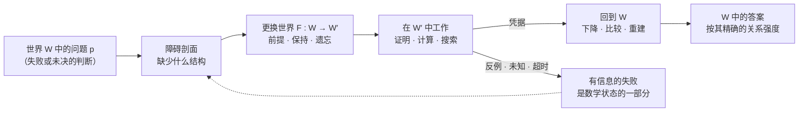

<p align="center">
  <a href="https://doi.org/10.5281/zenodo.23480696"></a>
</p>

<p align="center">
  <a href="https://doi.org/10.5281/zenodo.23480696"></a>
  <a href="https://creativecommons.org/licenses/by-nc-nd/4.0/deed.zh-hans"></a>
  <a href="https://github.com/AlienMuse/grothendieckian-machine/releases/tag/v1.0.0"></a>
  
  
  
  <a href="VERIFY.md"></a>
  <a href="VERIFY.md"></a>
</p>

<p align="center">
  <b><a href="https://github.com/AlienMuse/grothendieckian-machine/releases/download/v1.0.0/GAI-MUA-v1.0.0-Preview.pdf">阅读预览版</a></b>（328 页，51.8 MB）·
  <a href="#下载">下载</a> ·
  <a href="#六卷">六卷</a> ·
  <a href="#引用">引用</a> ·
  <a href="VERIFY.md">校验</a> ·
  <a href="README.md">English</a>
</p>

<br>

> *Major advances frequently arise not from manipulating isolated formulas more aggressively, but from
> constructing an ambient world in which the objects, transports, invariants, and local-to-global laws of a
> problem become visible.*
> <br>— Series Note
>
> 重大进展往往不是来自更用力地操纵孤立的公式，而是来自构造一个环境世界——在其中，问题的对象、传递、
> 不变量与局部到整体的规律得以显现。

**GAI-MUA: The Grothendieckian Machine** 是一部六卷本专著（正文为英文）。它把结构数学的实质内容——概形、
拓扑斯、下降、上同调、motive，以及高阶、导出、perfectoid、condensed 与远阿贝尔几何——与面向数学的人工智能
系统设计结合在一起。它追问：数学世界如何形成；论断在世界之内与世界之间如何获得依据；结构如何在有类型的数据中
被忠实表示；以及在精确来源、明确前提、独立验证与人类发布权威的约束下，计算如何辅助数学。

全书的核心论点：**数学智能的进步，在于构造、比较并治理那些使答案具有精确意义的世界。**

<table>
  <tr>
    <td align="center"><b>6</b><br><sub>卷<br>一部整体著作</sub></td>
    <td align="center"><b>603</b><br><sub>章</sub></td>
    <td align="center"><b>14,905</b><br><sub>页</sub></td>
    <td align="center"><b>110,000+</b><br><sub>公式<br>陈列公式 20,531 · 编号 8,022</sub></td>
    <td align="center"><b>11,397</b><br><sub>编号小节</sub></td>
    <td align="center"><b>830</b><br><sub>幅图</sub></td>
    <td align="center"><b>126</b><br><sub>算法契约<br>ALG-001 … ALG-126</sub></td>
  </tr>
</table>

这部著作同时是：

- **一部数学专著**——重建 Grothendieck 及其后的数学世界，从 EGA、SGA 与 *Pursuing Stacks*，到 perfectoid、
  prismatic 与 condensed 数学，并给出精确前提与可追溯的证明谱系；
- **一项数学方法与谱系的研究**——一个定理、一个定义或一个研究纲领究竟如何进入数学记录，追溯到最小的支撑来源单位；
- **一套面向数学的人工智能（AI for Mathematics）架构**——在其中，每个世界带有它的环境范畴、不变量与所支持的边界；
  每个定理带有它的前提、依赖闭包、来源谱系、证明凭据（proof receipt）与认识论状态；每座桥带有它保持了什么、丢失了什么——
  而失败是一种输出，不是错误；
- **一个受治理的自演化研究纲领**——系统可以改进检索、证明搜索与策略，而数学真理始终系于来源、证明与审查。

## 方法：更换环境世界

许多难题之所以难，是因为提出问题所用的语言压抑了表述正确不变量、比较或粘合律所需的结构。一种典型的
Grothendieck 式回应是：诊断这种压力，以有类型的方式**更换环境世界**（changing ambient worlds），并追问原本零散的
现象是否变得函子化、局部化、可表或可重建——同时记录得到了什么、失去了什么，以及结果如何回到原来的问题。



本书区分八种这样的操作，各有其前提与效果：**相对化**（底上的族）、**可表性**、**局部化与下降**、**范畴上升**（categorical ascent；
集合 → 广群 → 高阶叠）、**导出与稳定化**、**经由更大中介世界的比较**（étale、Betti、de Rham、晶体、prismatic……）、
**完备化、almost 等价与 tilting**，以及**从影子重建**（reconstruction from shadows；Galois 几何与远阿贝尔几何）。它们共同为 Grothendieck 的
「涨潮」（rising sea）意象赋予严格内容：用一个更宽广的理论包围难题，直到结构关系取代正面强攻——而每一次扩张都带有
明确的损失剖面（loss profile）与返回路径。贯穿六卷最深的数学连续性是下降：局部数据在相容性**与**有效性之下给出整体对象。

### 世界、桥、义务

这台机器的智能单位是结构化的探究，而不是孤立的答案。

- **世界**（world）是一个结构化的环境：其中表达式合乎规范，对象有类型，态射有协变或逆变之分，局部性有明确含义，论断有
  可接受的验证方式——示意地写作
  $W = (\mathcal{C}, \mathcal{O}, \mathcal{M}, \tau, \mathcal{L}, \mathcal{I}, \mathcal{T}, \mathcal{H}, \mathcal{B})$：
  环境范畴、对象、态射、局部性、逻辑与宇宙（universe）规范、不变量、允许的变换、常设前提——以及不可或缺的**边界**
  $\mathcal{B}$，即实际被支持的范围。
- **桥**（bridge）是世界之间有方向的关系——函子、伴随、局部化、实现、基变换、比较、截断、完备化、编译器或重建——
  记录其定义域条件、保持什么、反映什么、丢失什么，以及如何返回。
- **义务**（obligation）是一个图表、一次粘合或一个论断尚待偿付的东西：一个交换胞（commuting cell）、一个上闭链条件、一个有效性定理、
  一次可信内核的重放（kernel replay）。障碍——提升失败、非零的上同调类、不相容的重叠、反模型——是一等输出，不是错误。

### 统计置信度绝不冒充证明

全书遵循一套明确的认识论章程（epistemic constitution）。已确立的数学、结构性综合、提议的定义、研究纲领、
猜想、证明义务与有争议的主张被严格区分。一个定理只有在具备经过检查的陈述、完整的前提、精确的来源定位与
记录在案的依赖闭包时，才进入「已确立」层。如果目标已改变、假设被悄然加强，或可信内核尚未重放证明，生成的
形式化工件就不是证明。语言模型可以提议世界、寻找桥、把文字转译为候选表示；而精确来源、依赖闭包与关系强度
存放在外部可检查的工件中。**「未知」与「弃权」都是合法的结果。**

## 六卷

<table>
  <tr>
    <td width="33%" valign="top" align="center">
      <a href="https://github.com/AlienMuse/grothendieckian-machine/releases/download/v1.0.0/GAI-MUA-v1.0.0-Vol1-Foundations.pdf"></a><br>
      <b>I · Foundations of the Grothendieckian Universe</b><br>
      <sub>Schemes, Topoi, Descent, Cohomology, Motives, and Higher Structures</sub><br><br>
      <sub>120 章，分十二部。从作为文献来源的 EGA、SGA、FGA 与 <i>Pursuing Stacks</i>，到概形、site 与拓扑斯、下降、étale 上同调、叠、六函子、motive、远阿贝尔重建——以及建立在其上的研究工具。</sub><br><br>
      <a href="https://github.com/AlienMuse/grothendieckian-machine/releases/download/v1.0.0/GAI-MUA-v1.0.0-Vol1-Foundations.pdf">PDF</a> · <a href="docs/contents/volume-i.md">目录</a> · 3,742 页
    </td>
    <td width="33%" valign="top" align="center">
      <a href="https://github.com/AlienMuse/grothendieckian-machine/releases/download/v1.0.0/GAI-MUA-v1.0.0-Vol2-Modern-Synthesis.pdf"></a><br>
      <b>II · The Modern Grothendieckian Synthesis</b><br>
      <sub>Higher, Derived, Motivic, Perfectoid, Condensed, and Anabelian Geometry</sub><br><br>
      <sub>120 章，分十二部。基础思想如何被推广、修正与重组：Hodge 理论与权（weight）、导出模问题、p 进 Hodge 理论、∞-范畴、perfectoid 空间与 diamond、prismatic 与 condensed 数学——并设有明确的争议主张防火墙。</sub><br><br>
      <a href="https://github.com/AlienMuse/grothendieckian-machine/releases/download/v1.0.0/GAI-MUA-v1.0.0-Vol2-Modern-Synthesis.pdf">PDF</a> · <a href="docs/contents/volume-ii.md">目录</a> · 4,016 页
    </td>
    <td width="33%" valign="top" align="center">
      <a href="https://github.com/AlienMuse/grothendieckian-machine/releases/download/v1.0.0/GAI-MUA-v1.0.0-Vol3-Architecture.pdf"></a><br>
      <b>III · Architecture of the Grothendieckian Machine</b><br>
      <sub>Categorical Intelligence, Verified Knowledge, and Mathematical Universe Engines</sub><br><br>
      <sub>93 章。哲学语言在这里变成契约语言：世界规格、有类型的映射、作为类型的认识论状态、证明凭据，以及 GMUS、GMLS 与下降推理架构。</sub><br><br>
      <a href="https://github.com/AlienMuse/grothendieckian-machine/releases/download/v1.0.0/GAI-MUA-v1.0.0-Vol3-Architecture.pdf">PDF</a> · <a href="docs/contents/volume-iii.md">目录</a> · 1,815 页
    </td>
  </tr>
  <tr>
    <td width="33%" valign="top" align="center">
      <a href="https://github.com/AlienMuse/grothendieckian-machine/releases/download/v1.0.0/GAI-MUA-v1.0.0-Vol4-Algorithms.pdf"></a><br>
      <b>IV · Algorithms of Grothendieckian Intelligence</b><br>
      <sub>Categorical Computation, Formal Reasoning, and Verifier-Grounded Discovery</sub><br><br>
      <sub>118 个章节单元与冻结的 126 个算法目录。有效片段（effective fragment）、基础中间表示（IR）、有限 site 与经认证的下降、realization prism、证明搜索、反例生成——以及「执行」（execution）与「依据」（warrant）之间的界线。</sub><br><br>
      <a href="https://github.com/AlienMuse/grothendieckian-machine/releases/download/v1.0.0/GAI-MUA-v1.0.0-Vol4-Algorithms.pdf">PDF</a> · <a href="docs/contents/volume-iv.md">目录</a> · 2,089 页
    </td>
    <td width="33%" valign="top" align="center">
      <a href="https://github.com/AlienMuse/grothendieckian-machine/releases/download/v1.0.0/GAI-MUA-v1.0.0-Vol5-Modular-Machine.pdf"></a><br>
      <b>V · The Modular Grothendieckian Machine</b><br>
      <sub>Verified Kernels, Mathematical Systems, and Reference Implementation</sub><br><br>
      <sub>72 章。在七角色宪制分离之下的模块化参考平台；Lean 4、Coq、Isabelle、SAT/SMT、Sage、GAP、Singular 与 PARI 的适配器——每个适配器的权限仅限于它实际检查的谓词。</sub><br><br>
      <a href="https://github.com/AlienMuse/grothendieckian-machine/releases/download/v1.0.0/GAI-MUA-v1.0.0-Vol5-Modular-Machine.pdf">PDF</a> · <a href="docs/contents/volume-v.md">目录</a> · 1,146 页
    </td>
    <td width="33%" valign="top" align="center">
      <a href="https://github.com/AlienMuse/grothendieckian-machine/releases/download/v1.0.0/GAI-MUA-v1.0.0-Vol6-Self-Evolution.pdf"></a><br>
      <b>VI · The Self-Evolving Grothendieckian Machine</b><br>
      <sub>Reinforcement Learning, Descent-Coherent Co-Evolution, and Recursive Mathematical Discovery</sub><br><br>
      <sub>80 章。不是一个自我改进的模型，而是一组受治理的演化语境的联邦：分层强化学习、奖励章程、安全探索——奖励永远不能替代证明或授权。</sub><br><br>
      <a href="https://github.com/AlienMuse/grothendieckian-machine/releases/download/v1.0.0/GAI-MUA-v1.0.0-Vol6-Self-Evolution.pdf">PDF</a> · <a href="docs/contents/volume-vi.md">目录</a> · 1,485 页
    </td>
  </tr>
</table>

**完整合卷**（[PDF](https://github.com/AlienMuse/grothendieckian-machine/releases/download/v1.0.0/GAI-MUA-v1.0.0-Complete.pdf)，14,905 页）是标准阅读版本；六个分卷是同一部著作的分发版本。

## 从哪里开始

| 读者 | 先读 | 再读 |
|---|---|---|
| **数学家**——代数几何、拓扑、算术几何、范畴论 | 第 I 卷的 Architectural Prospectus 及其开篇的来源批判章节 | 相关主题部分；第 I、II 卷末尾的综合研究工具 |
| **AI 研究者** | 综合前言（Integrated Preface），然后第 III 卷第 1–13 章 | 第 IV 卷第 1–2 部；第 V 卷的宪制章节；第 VI 卷 |
| **形式化与证明工程师** | 第 I 卷的来源与定理谱系章节；前言中的记号与状态约定 | 第 III 卷的工件与证明凭据契约；第 IV 卷的编译器、target-fidelity guard 与证明重放；第 V 卷的 Lean、Coq、Isabelle 适配器 |
| **软件与系统工程师** | 第 V 卷第 1–12 章 | 存储、工作流、API、安全与发布章节；第 III、IV 卷给出原因与算法 |
| **历史学者与编辑** | 第 I、II 卷的来源批判谱系；认识论章程 | 第 V 卷的发布章节 |

读书小组可以按书中给出的五步循环：第 I 或 II 卷的一章数学 → 它的世界更换与来源谱系 → 第 III 卷中对应的契约 →
第 IV 卷的算法片段与第 V 卷中的模块 → 第 VI 卷中可以演化、而真理条件保持不变的部分。

**第一次来？[阅读预览版](https://github.com/AlienMuse/grothendieckian-machine/releases/download/v1.0.0/GAI-MUA-v1.0.0-Preview.pdf)**——包括 Series Note、31 页的综合前言、完整目录与第 I 卷第 1 章。

## 本书是什么，不是什么

- **是研究架构，不是已完成的通用求解器。** 完成性主张仅限于精确的局部结果。
- **规格与实现分开。** 第 III–VI 卷给出规范性架构、提议的契约与参考平台设计；实现状态是另一项主张，只由已分配的
  组件、可执行程序、测试、重放凭据与发布证据承载。
- **覆盖面有选择。** 完整的前提与证明保留在原始与现代文献中，本书在最小的支撑来源单位上引用它们。
- **类比的作用有界。** 把下降的语言用于软件、发布或协同演化，在给出 site、覆盖、重叠、上闭链与有效性数据之前，始终只是类比。
- **有争议的数学仍是有争议的。** 对 IUT 的处理把文献、批评与回应作为不同事件记录，并设有明确的防火墙。

## 下载

| | 文件 | 页数 | 大小 |
|---|---|---:|---:|
| **预览版**——从这里开始 | [GAI-MUA-v1.0.0-Preview.pdf](https://github.com/AlienMuse/grothendieckian-machine/releases/download/v1.0.0/GAI-MUA-v1.0.0-Preview.pdf) | 328 | 51.8 MB |
| **完整合卷**（第 I–VI 卷） | [GAI-MUA-v1.0.0-Complete.pdf](https://github.com/AlienMuse/grothendieckian-machine/releases/download/v1.0.0/GAI-MUA-v1.0.0-Complete.pdf) | 14,905 | 780.9 MB |
| 第 I 卷 | [GAI-MUA-v1.0.0-Vol1-Foundations.pdf](https://github.com/AlienMuse/grothendieckian-machine/releases/download/v1.0.0/GAI-MUA-v1.0.0-Vol1-Foundations.pdf) | 3,742 | 240.0 MB |
| 第 II 卷 | [GAI-MUA-v1.0.0-Vol2-Modern-Synthesis.pdf](https://github.com/AlienMuse/grothendieckian-machine/releases/download/v1.0.0/GAI-MUA-v1.0.0-Vol2-Modern-Synthesis.pdf) | 4,016 | 165.2 MB |
| 第 III 卷 | [GAI-MUA-v1.0.0-Vol3-Architecture.pdf](https://github.com/AlienMuse/grothendieckian-machine/releases/download/v1.0.0/GAI-MUA-v1.0.0-Vol3-Architecture.pdf) | 1,815 | 215.0 MB |
| 第 IV 卷 | [GAI-MUA-v1.0.0-Vol4-Algorithms.pdf](https://github.com/AlienMuse/grothendieckian-machine/releases/download/v1.0.0/GAI-MUA-v1.0.0-Vol4-Algorithms.pdf) | 2,089 | 95.1 MB |
| 第 V 卷 | [GAI-MUA-v1.0.0-Vol5-Modular-Machine.pdf](https://github.com/AlienMuse/grothendieckian-machine/releases/download/v1.0.0/GAI-MUA-v1.0.0-Vol5-Modular-Machine.pdf) | 1,146 | 98.5 MB |
| 第 VI 卷 | [GAI-MUA-v1.0.0-Vol6-Self-Evolution.pdf](https://github.com/AlienMuse/grothendieckian-machine/releases/download/v1.0.0/GAI-MUA-v1.0.0-Vol6-Self-Evolution.pdf) | 1,485 | 136.2 MB |

全部文件同时永久存档于 Zenodo：**[doi.org/10.5281/zenodo.23480696](https://doi.org/10.5281/zenodo.23480696)**。在中国大陆如 GitHub 下载较慢，
可改从 Zenodo 下载。

## 引用

泛指本作品时引用**概念 DOI** [10.5281/zenodo.23480696](https://doi.org/10.5281/zenodo.23480696)（始终指向最新版本）；引用本版本时使用版本 DOI
[10.5281/zenodo.23480697](https://doi.org/10.5281/zenodo.23480697)。仓库页面右侧的 **Cite this repository** 按钮使用 [CITATION.cff](CITATION.cff)。

> Liu, V. (2026). *GAI-MUA: The Grothendieckian Machine — A Mathematical Universe Architecture for Verifiable
> and Self-Evolving Artificial Intelligence* (Research Architecture Edition 1, version 1.0.0). Zenodo.
> https://doi.org/10.5281/zenodo.23480696

BibTeX 见[英文说明](README.md#citation)。

## 真实性

每个发布文件都列在 [`SHA256SUMS`](SHA256SUMS) 中，由作者的 OpenPGP 密钥签名（`DA1A 1AEF D8B2 C17C FF3F 1D1B 3905 0F50 7A4F EC17`，亦见
[github.com/AlienMuse.gpg](https://github.com/AlienMuse.gpg)），由两家独立的 RFC 3161 时间戳机构（FreeTSA 与 DigiCert）
加盖时间戳，并通过 OpenTimestamps 锚定在比特币区块链上。

```sh
sha256sum -c SHA256SUMS --ignore-missing          # 完整性
gpg --import VincentLiu-signing-key.asc && gpg --verify SHA256SUMS.asc SHA256SUMS   # 作者身份
ots verify SHA256SUMS.ots                          # 存在时间
```

逐步说明（含 Windows）：[VERIFY.md](VERIFY.md)。

## 许可与 AI 使用

- **著作本身**采用 [CC BY-NC-ND 4.0](LICENSE) 许可：署名、非商业、不得修改，在此前提下可自由分享。
- **书中印出的代码清单与机器可读 schema** 另以 [Apache License 2.0](LICENSES/Apache-2.0.txt) 授权，见
  [NOTICE.md](NOTICE.md)。书中的思想、方法、架构与算法可以自由实现。
- **保留文本与数据挖掘权利**（欧盟指令 2019/790 第 4(3) 条）。用本书训练或微调机器学习模型须事先获得书面许可；
  **个人读者可以使用 AI 工具阅读、检索、解释或翻译本书**用于自己的学习。见 [TDM-AND-AI-POLICY.md](TDM-AND-AI-POLICY.md)。

## 参与方式

本仓库发布的是一部定稿的学术著作，正文不接受 pull request。最有帮助的是：

- **勘误**——用[勘误表单](https://github.com/AlienMuse/grothendieckian-machine/issues/new?template=errata.yml)报告；确认的更正列入 [ERRATA.md](ERRATA.md)，
  并进入下一版。
- **讨论**——问题、读书笔记与研究方向，欢迎在 [Discussions](https://github.com/AlienMuse/grothendieckian-machine/discussions) 交流。
- **实现**——欢迎独立实现或检验书中思想的工作；请注明引用，命名方式见 [TRADEMARKS.md](TRADEMARKS.md)。

术语对照：[docs/terminology-zh.md](docs/terminology-zh.md)。

如果这部著作对你有用，**为仓库点一个 Star**，可以帮助更多数学家与 AI 研究者发现它。

---

<p align="center">
  <sub>
    <b>GAI-MUA: The Grothendieckian Machine</b> · Research Architecture Edition 1 · version 1.0.0<br>
    WiseMotif Monograph of Mathematical Intelligence, Series 01 · Mathematics and Artificial Intelligence ·
    <a href="https://wisemotif.ai">WiseMotif.ai</a><br>
    © 2026 Vincent Liu · <i>Grothendieckian Machine</i> 指本书提出的研究架构；该名称不表示 Alexander Grothendieck
    本人参与设计或认可。
  </sub>
</p>
